# DirXMLDevWeb

> **Beta.** DirXMLDevWeb is a beta release. It is in active use against lab and test trees, but
> expect rough edges and changes between versions. It can deploy to an Identity Vault, so try it on
> a non-production tree first. See [docs/features.md](docs/features.md) for what it does and
> [CHANGELOG.md](CHANGELOG.md) for what changed.

A browser workbench for NetIQ / OpenText Identity Manager driver sets, over the
[DirXMLDev](https://github.com/PointBlueTechnology/DirXMLDev) core: Designer's job, done on an
IDM-as-code tree in git. It runs as a container on your own machine for one person, on a server
for a team, or from a checkout on a workstation — see [Three ways to run it](#three-ways-to-run-it).

Every phase of [docs/design.md](docs/design.md) is built: editors, vault, simulator, provisioning,
packages, hosted mode. **New here? [docs/quickstart.md](docs/quickstart.md)** — one container, one
command — then [docs/tutorial.md](docs/tutorial.md), from reading a vault to your first deploy.

## A look

**Architecture** — the driver set as Designer's Modeler draws it: the Identity Vault in the
middle, one card per driver with its icon and shim, live state from the vault when it can be
reached, and SVG or PNG to download.

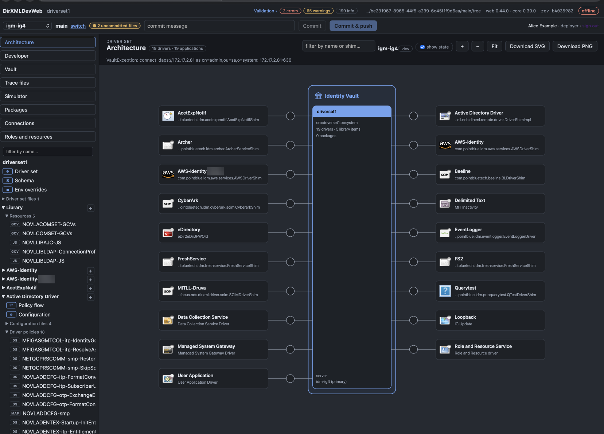

**Adding a project** — the first run, and "add a project…" after it: a tree comes from an
Identity Vault, a Designer project or export, a repository on the host, a directory of files,
or a remote to clone.

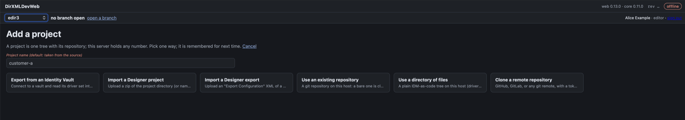

**The driver set** — one card per driver, the validation counts in the top bar, the findings
grouped by driver on the right.

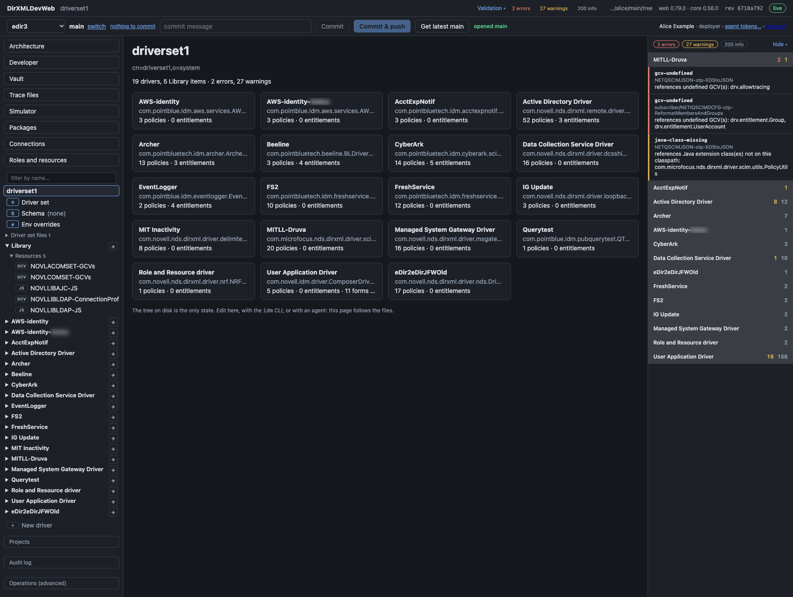

**Policy flow** — a driver's fishbone: both channels' policy sets with their policies in order,
the schema mapping and input/output transformations on the spine, the filter and the
driver-level sets below. Hover a policy for its description, click one to open it.

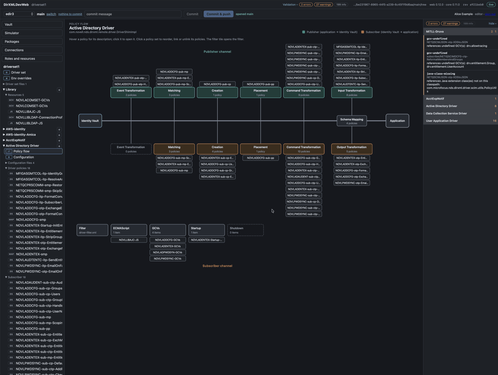

**Reordering a policy set** — click a set in the flow and it opens beside the picture: move
policies up and down, unlink one, link an existing one; the change is reviewed before it is
written.

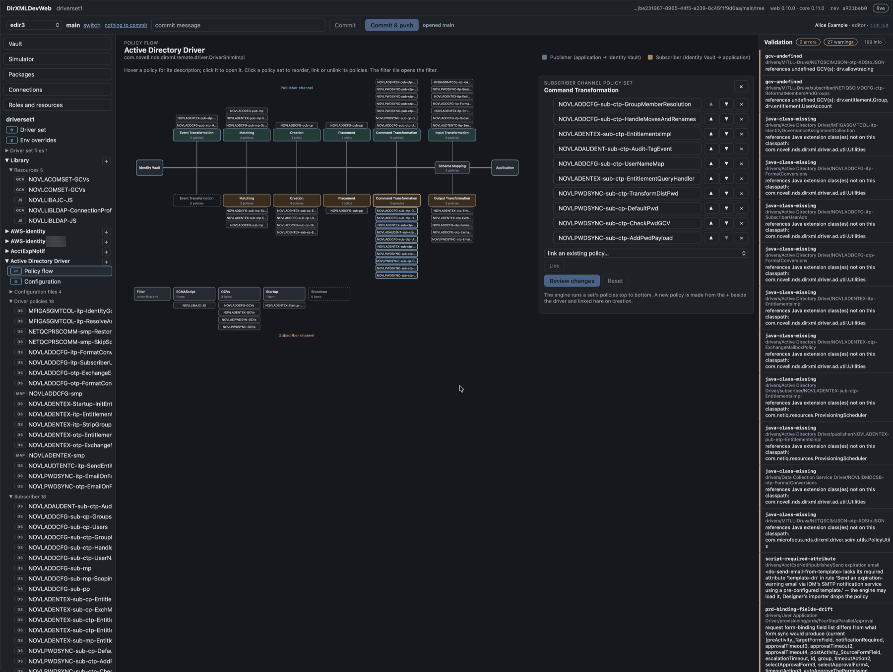

**Policy sets** — every set of the driver as an ordered list, on the configuration view.

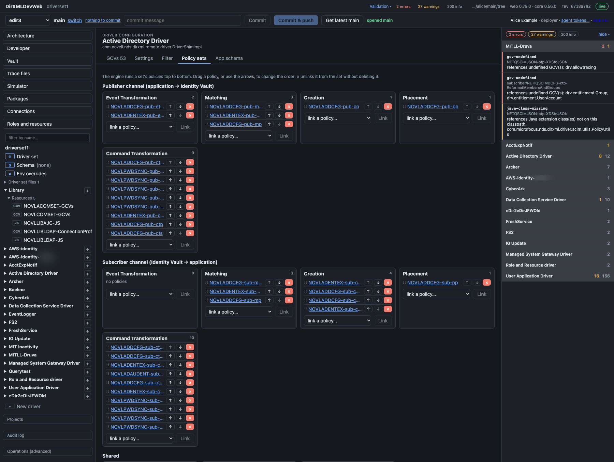

**GCVs** — each global configuration value in the driver's scope, where it is defined, and
every policy that reads it.

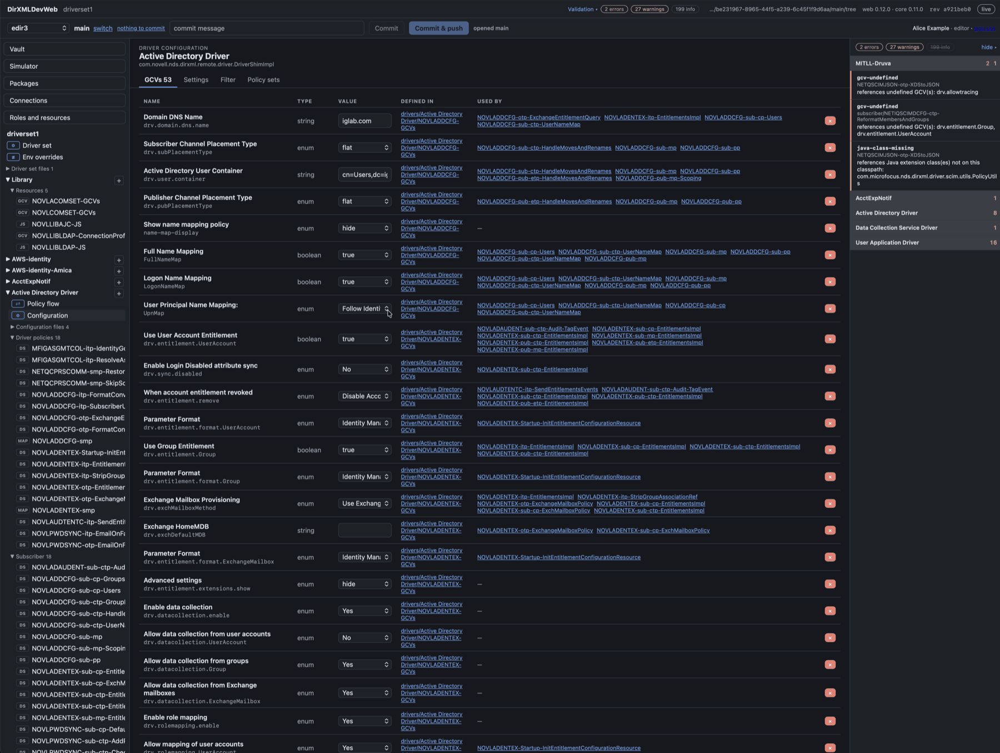

**Settings** — shim class and authentication, the shim's parameters, the engine control values.

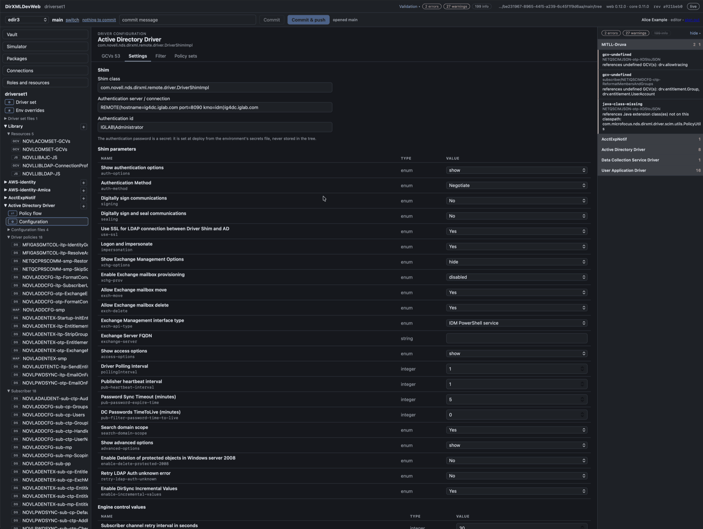

**Filter** — the classes and attributes the driver synchronises, with each channel's setting
and the merge authority.

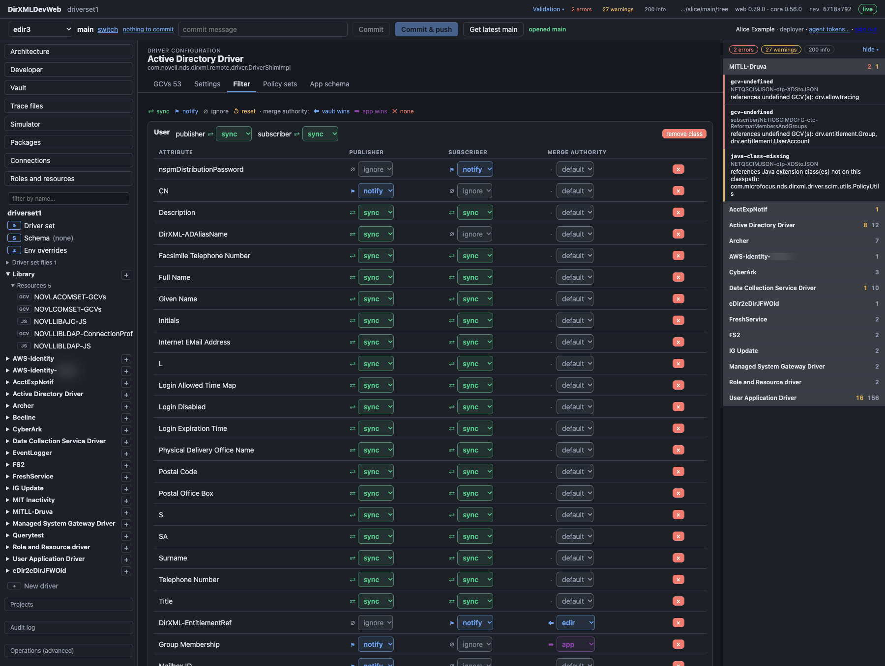

**Reviewing a change** — every edit is planned on a copy of the tree first: the pending change,
the files it touches and a side-by-side diff of each. Nothing is written until *Apply*.

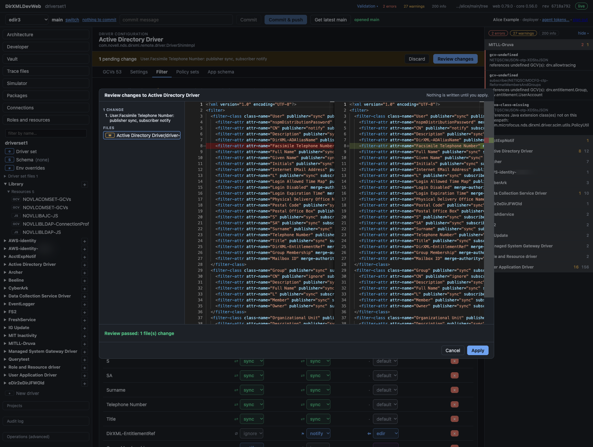

**Schema map** — the eDirectory-to-application class and attribute mapping as a table.

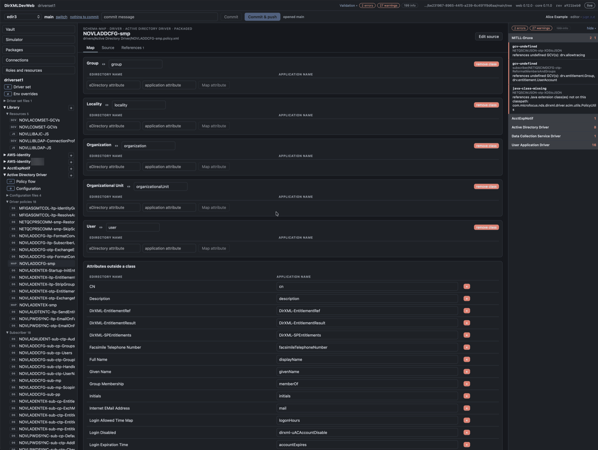

**A provisioning request definition** — the workflow of a User Application PRD drawn from its
process: activities, branches and merges, approval and condition links; select an activity to
change it.

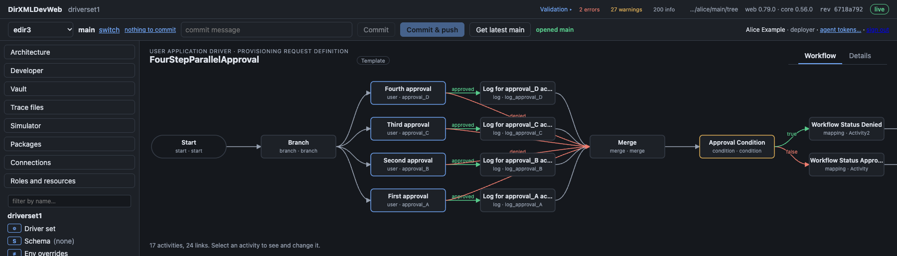

**Live trace** — the driver set's trace streamed from the vault into the page, from every server
or one: channel, driver and text filters, find, the engine's colours and the XML highlighted, a
pop-out window, and recording to a file.

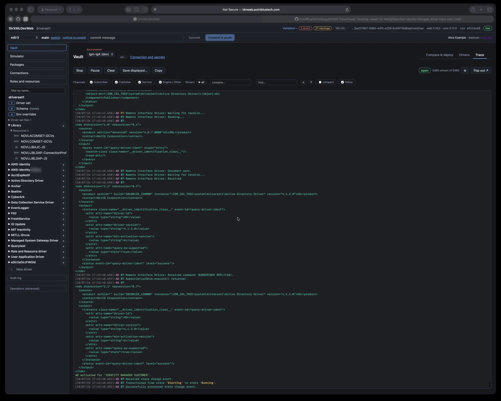

## What it is, and is not

It is a third client of the DirXMLDev core, next to the `idm` CLI and DirXMLDev's MCP server. The page
calls the same typed operations they call, so anything the core can do, it can do, with the
same validation and the same refusals. It is not a port of Designer and contains no OpenText
code. The tree on disk (in git) is the only state: edit here, with the CLI or with an agent, and
the page follows the files.

## What it does

Everything Designer does for a driver set, as pages over the tree on disk: the outline and the
policy flow; structured editors for policies, filters, schema maps, mapping tables, GCVs,
settings, policy sets and environment overrides; entitlements, PRDs, forms, roles and resources;
compare and deploy against a vault, driver control and live trace; the simulator; packages and
update sites; connections and secret managers; and in hosted mode, projects, branches, commits
and pull requests, sign-in and audit. Every write goes through one review (a dry run on a copy
of the tree, file by file) and is applied as one transaction, or not at all. The whole list,
view by view: [docs/features.md](docs/features.md).

**Your agents too.** The server is an MCP server (`/mcp`). Make a token on the page, connect Claude
Code, Cursor or a script, and run the `setup` prompt: the agent gets this version's rules, skills
and docs from the server and acts as you, under your roles, with the same previews, plan and
typed confirmation before a vault write as the page. The `idm`, `sim` and `apps` CLIs are in the
image too. [docs/agents.md](docs/agents.md).

## Three ways to run it

| | **Local** — one person, one container | **Server** — a team | **Workstation** — from a checkout |
|---|---|---|---|
| Where | Docker on your own machine (macOS, Windows or Linux; nothing else to install), `http://localhost:8080`; everything it keeps is in one folder on your disk (`~/idmweb/`) | a host behind a proxy with TLS, `https://idm.example.com` | your machine, `bin/idmweb serve <tree>`, loopback only |
| Sign-in | one token (yours) and one for your agents | your identity provider (OpenID Connect: Keycloak, Entra, Okta …), groups → roles | none: the URL carries a one-time token |
| The tree | a git repository in that folder, `~/idmweb/repo.git` (or none yet: the page asks) | the team's repository on GitHub or GitLab; a branch per person as a workspace | one tree on disk, edited in place; when it is a git checkout, the page commits, pushes and opens pull requests (through `gh` or `glab`) on the branch it is on |
| Projects, branches, sign-in, roles, audit | yes | yes | no — one tree, one person, no audit |
| Vault credentials | the environments (URL, driver set, tier) in `~/idmweb/config/environments.properties`; your bind DN and password in your own file, `~/idmweb/data/users/<you>/environments.properties`, readable by you alone, or a variable you set in `~/idmweb/idmweb.env`; never in the tree, never in eDirectory | the definitions in one file on the server; each person's bind DN and password in their own owner-only file; a deployer may use a secret manager | the `idm` CLI's file (secrets included), your macOS Keychain, or a secret manager |
| Engine jars | optional (compile check, simulator): `~/idmweb/lib/`, mounted into the container | a folder on the host, mounted into the container | DirXMLDev's `lib/` |
| CLI and simulator | `docker exec idmweb idm …` | `docker exec idmweb idm …` | `bin/idm …` from the checkout |
| Get it | two commands: [docs/quickstart.md](docs/quickstart.md) | [docs/hosted-install.md](docs/hosted-install.md), [docs/hosted-mode.md](docs/hosted-mode.md) | [docs/development.md](docs/development.md) |

The first two are the same image and the same hosted server (`serve --hosted`), one configured
for one person on localhost and one for a team; the third is the server in its local mode,
for developing it or for a quick look at a tree. Upgrading an install is running the next image:
[docs/upgrading.md](docs/upgrading.md).

## Documentation

| | |
|---|---|
| [docs/quickstart.md](docs/quickstart.md) | one person, one container, one command |
| [docs/tutorial.md](docs/tutorial.md) | a new install to a first deploy: read a vault, change a policy, commit, deploy |
| [docs/git-workflow.md](docs/git-workflow.md) | working with git: branches, dev/test/production of one driver set, promotion, merging into main, remotes |
| [docs/features.md](docs/features.md) | every view, by area |
| [docs/agents.md](docs/agents.md) | agents: tokens, connecting Claude Code or Cursor, the setup prompt, every MCP tool and its arguments, the CLIs, the agent kit |
| [docs/data-model.md](docs/data-model.md) | projects, workspaces, trees, environments and vaults: the entity relationship diagram |
| [docs/multi-user.md](docs/multi-user.md) | what's yours and what's shared on a hosted server: vault sign-ins, tokens, traces, the files they live in |
| [docs/pull-requests.md](docs/pull-requests.md) | pull requests from the page: providers, whose account, the workstation's `gh` / `glab`, the API |
| [docs/hosted-install.md](docs/hosted-install.md) | the container for a team: image, host layout, proxy, Keycloak, the lab |
| [docs/hosted-mode.md](docs/hosted-mode.md) | hosted configuration: projects, repositories, identity (`token`, `oidc`, `none`), roles, agents |
| [docs/security.md](docs/security.md) | what the server refuses, where credentials live, what never leaves it; how the workstation and hosted modes differ |
| [docs/secret-managers.md](docs/secret-managers.md) | AWS, Azure, GCP, CyberArk, BeyondTrust, Bitwarden, Terraform: a credential as a command |
| [docs/development.md](docs/development.md) | running from a checkout, layout, tests, releasing |
| [docs/limits.md](docs/limits.md) | what still goes through Operations or the CLI |
| [docs/design.md](docs/design.md) | historical: the assessment and phases from before it was built, and why it is built this way |
| [docs/project-per-environment.md](docs/project-per-environment.md) | design note (proposed): a project per environment, comparing two projects and promoting changes between them with a record of what moved |
| [docs/connections-ui.md](docs/connections-ui.md) | design note (built in 0.61.0): the Connections page, and the layout rules every form follows: required before optional, one status and one action per row, rotated passwords made obvious |
| [CHANGELOG.md](CHANGELOG.md) | every release |

## License

[MIT](LICENSE). The image and the jars hold nothing of OpenText's. The engine jars that validate's
compile check and the simulator need are yours, mounted from your own Identity Manager; vault
access needs none of them. [THIRD-PARTY.md](THIRD-PARTY.md) lists what a release carries, with
the licenses.

## Security

Report vulnerabilities privately: see [SECURITY.md](SECURITY.md).

## Trademarks

DirXMLDevWeb is made by [Point Blue Technology](https://pointbluetech.com). It is not affiliated with,
endorsed by or supported by OpenText. NetIQ, eDirectory, Identity Manager and OpenText are trademarks of
OpenText or its affiliates; other names belong to their owners.
