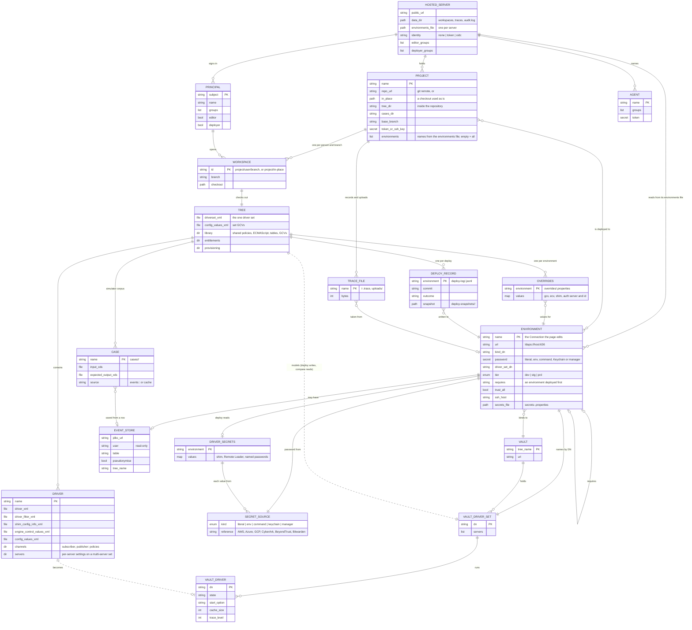

# Data model: projects, workspaces, trees, environments and vaults

How the web server and the `idm` core name the things they work with, and how those things
relate. The rule that holds it together: **a tree is one driver set**, and **an environment is
one place that driver set is deployed to** — a vault URL plus a driver-set DN plus a tier. A
vault may hold several driver sets, so one vault can stand behind several environments; a
project's tree is deployed to its own environments and no others.

## Entity relationship diagram

Solid lines are references the configuration holds (a name, a DN, a path). Dotted lines are the
deploy relationship: the tree describes a driver set, and deploy, compare and the driver
operations act on the one the environment names.

## The entities

| Entity | Where it lives | What it is |
|---|---|---|
| **Hosted server** | `hosted.properties` | One web server: its public URL, data directory, identity provider, the groups that make an editor or a deployer, *the* environments file it reads, the projects it holds. Local mode has none of this: one process, one tree, one person. |
| **Project** | `project.<name>.*` in `hosted.properties` | One tree repository the server holds: a git remote (or a checkout used in place), the tree and cases directories inside it, the base branch, its own token or deploy key, and the environments its tree is deployed to. |
| **Principal** | the identity provider (OIDC groups), `token.user` (`identity=token`, the local container: every role), or `none.users` (tests) | A signed-in person: subject, groups, and from the groups the editor and deployer roles. A **session** is a principal plus the workspace they have open. |
| **Agent** | `agents=` and `agent.<name>.token*` | A named bearer token with groups, for an automation or an AI agent; it opens workspaces like a person. |
| **Workspace** | `data.dir/workspaces/<project>/<user>/<branch>` | A checkout of one project on one branch for one person, with the services over it (tree, vault, simulator, packages, credentials, events, traces). In-place projects have one workspace, `<project>/in-place`. Local mode has exactly one: the tree on the command line. |
| **Tree** | `tree/` in the repository | **One driver set** as files: `driverset.xml`, set GCVs, the drivers, the shared library, entitlements, provisioning (see the core's `docs/tree-layout.md`). |
| **Driver** | `tree/drivers/<driver>/` | A driver's `driver.xml`, filter, shim configuration, engine control values, GCVs, channel policies, and on a multi-server set the per-server settings under `servers/<server>/`. |
| **Overrides** | `overrides/<env>.properties` beside the tree | The values that differ per environment (GCVs, ECVs, shim parameters, the authentication server and id). The tree keeps the base value; a deploy to that environment applies its file. |
| **Case** | `cases/<name>/` | A simulator case: `input.xds`, the recorded `expected-output.xds`, `case.properties` naming the driver and channel and where the input came from (an event-store row, a cache event). |
| **Deploy record** | `deploy-log/<env>.jsonl`, `deploy-snapshots/<env>/` | One line per deploy or driver operation, and the LDIF (or cache XDS) snapshot taken before the write. The production gate (`requires`) reads the log. |
| **Environment** | the environments file: `<name>.*` (hosted: the definitions there, and each person's bind DN and password in `data.dir/users/<subject>/environments.properties`) | **A place a driver set is deployed to**: a vault URL, a bind DN, where the password comes from, the driver-set DN, the tier, an optional prerequisite environment, trust, the SSH host for the trace tail, the secrets file, the event store. The page calls it a **Connection**; the Connections view writes this entry. |
| **Driver secrets** | `secrets-<env>.properties` | The shim, Remote Loader and named passwords a deploy to that environment needs, each a stored value or a reference to a secret manager. Never read back. |
| **Secret source** | the suffix of a key: `password`, `passwordEnv`, `passwordCommand`, `passwordKeychain`, or a manager reference | Where any secret comes from. On a macOS workstation the web stores a typed value in the Keychain by default, else in the owner-only file; the container has no Keychain, and on a hosted server a person's own reference is a deployer's (docs/security.md). |
| **Event store** | `<name>.events*` on the environment | The Event Logger's PostgreSQL table for that environment: JDBC URL, read-only user, table, whether people are pseudonymised on the way out, the tree name its DNs start with. |
| **Vault** | an eDirectory tree, reached by URL | The identity vault itself. It holds driver sets; several environments may bind to the same vault with different driver-set DNs, or to different replicas of the same tree. |
| **Vault driver set / driver** | objects in the vault | What is actually running: the set's servers, and each driver's state, start option, cache and trace level. Compare and deploy read and write these; the driver operations act on them. |
| **Trace file** | `data.dir/users/<subject>/traces/<project>/` (hosted), `~/.idm/traces/local/` (workstation) | A recording of the live trace of one environment (one driver or all), or an uploaded file. Per person and project, not per workspace, so a recording survives a branch. |

## How the pieces are scoped

| Thing | Hosted | Local |
|---|---|---|
| Environments file | one per server (`environments.file`, definitions only), shared by every project, merged with each person's own credentials file; a project lists the names that apply to it | `IDM_ENVIRONMENTS`, else the working directory's, else `~/.idm/environments.properties`; secrets included |
| Chosen environment | one remembered choice per browser (`localStorage`), offered from the project's list | the same, from the file |
| Credentials | no Keychain in the container; a person's password goes to their own owner-only file (a reference, a deployer's only) | the macOS Keychain by default, else the file or a reference |
| Workspaces | one per project, person and branch | one |
| Trace recordings | `data.dir/users/<subject>/traces/<project>` | `~/.idm/traces/local` |
| Audit log | `data.dir/audit.log`: session, workspace, event, outcome | none |

## What follows from the model

- A **tree is one driver set**, so the environment pickers in the Vault, Schema and App schema
  views are one choice: which of this tree's environments to look at. A tree is never compared
  with a driver set it is not deployed to.
- Two projects may share a vault (two driver sets in one tree) and still have separate
  environments, because an environment is the pair (vault, driver set).
- An environment's secrets are the tree's concern (the secrets file sits beside the tree and the
  overrides file names the environment), while the bind password is the environments file's.
  Neither is ever committed.
- Per-person environments (issue #47) would add a second environments file, read after the
  server's, with the same names and the same project filter.
