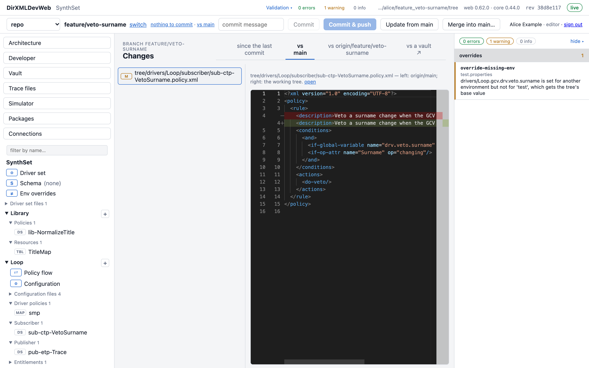
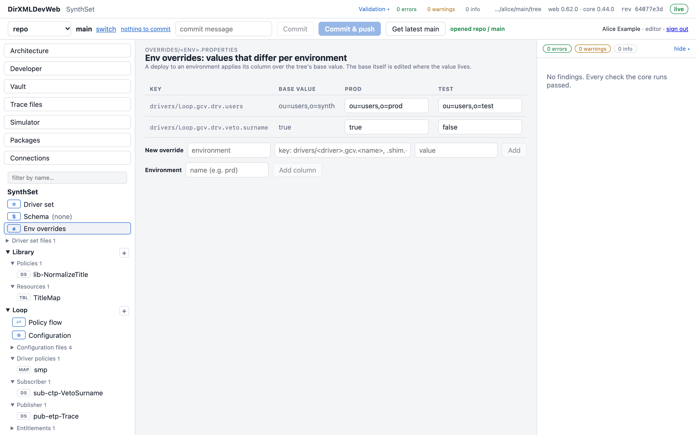
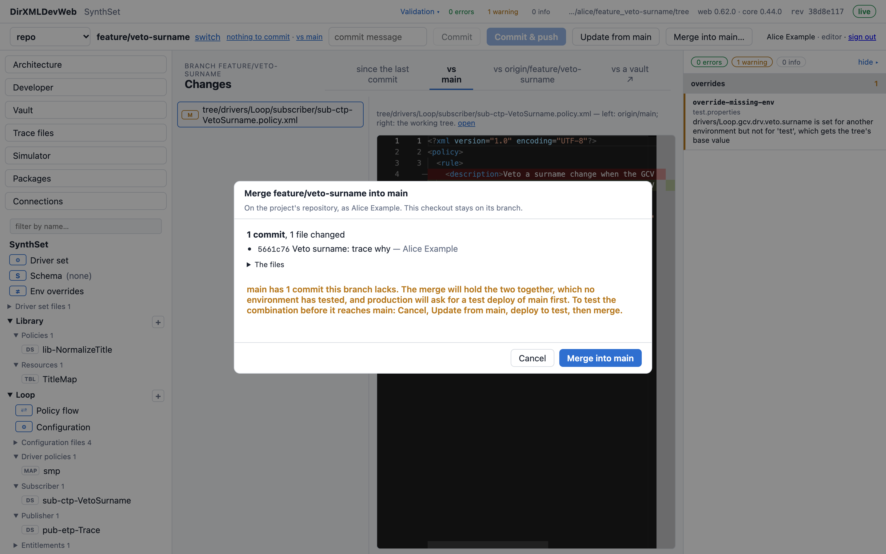
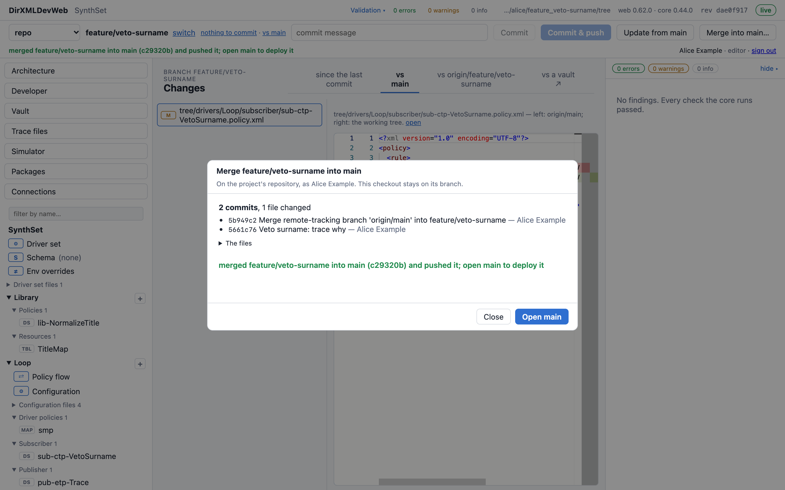

# Working with git: branches, environments and promotion

This guide explains how DirXMLDevWeb keeps a driver set in git. It recommends a way to work:
- with the dev, test and production vaults of one driver set;
- when to start a branch;
- how a change gets back into `main` and from there into production;
- where the repository lives.

It assumes you have done the [tutorial](tutorial.md): you have a project, a vault, and you have
committed and deployed once.

The screenshots use a synthetic driver set, *SynthSet*, with one Loopback driver. Alice is an
editor, and Bob a deployer.

## The short version

- **One driver set is one project, with one repository and one tree.** Dev, test and production
  are **environments**, the vaults that same tree deploys to. They are not branches and not
  copies.
- **What differs between environments** goes in the environments' **overrides**: GCVs, shim
  settings, the shim's server and account. Passwords go in each environment's **secrets**. None of
  this goes in a branch.
- **A change starts on a branch of its own.** Deploy it to dev from there, as often as you like.
- **Merge it into `main`.**
  - On GitHub or GitLab, use a pull request.
  - Otherwise, use **Merge into main…** on the bar.
- **Promote from `main`:** deploy the same content to test, then to production. Production takes
  only what `main` holds on the repository, and only once test has had exactly that content.

## 1. How the page uses git

### The repository and the base branch

Every project has a repository and a **base branch**, usually `main`. New branches start from it,
and pull requests and merges go into it. **Projects → Repository** shows both.

### Your own copy of each branch

When you open a branch, the server makes a checkout of it for you alone:

```
data/workspaces/<project>/<you>/<branch>
```

Everything the page edits, validates, compares and deploys is that checkout's files. Two people on
the same branch each have their own copy. They see each other's work only once it is pushed, and
then only after they bring it in.

A project used **in place** (a checkout on the server's host, not a repository) is the exception:
it is one person's working copy, and the page lets only that person open it.

### The bar at the top



From left to right:

| On the bar | What it does |
|---|---|
| the project, the branch, **switch** | **switch** lists *Your branches* (on this server, pushed or not) and *On the repository*. **new branch…** starts one from the base branch, as the repository has it now. |
| **● N uncommitted files** / *nothing to commit* | What differs from your last commit. Choose it to see the files. |
| **↑ N to push** | Commits you made that the repository doesn't have yet. |
| **vs main** | What your branch carries that `main` doesn't: what a merge would bring in. |
| **Commit**, **Commit & push**, **Push** | Commit records on your copy only. Push sends your commits to the repository. |
| **Update from main** | Brings what was merged into `main` since you started into your branch. |
| **Merge into main…** | Merges your branch into `main` on the repository (see [section 5](#5-merging-back-into-main)). Shown when the repository is not on GitHub or GitLab. |
| **Create pull request…** / **#12 open ↗** | On GitHub or GitLab: opens the request, or links to it. |
| **Get latest main** | On `main` itself: brings in what others merged since your copy was taken. |

### What the repository holds

| Path in the tree | What it is | Committed? |
|---|---|---|
| `drivers/`, `library/`, `driverset.xml`, … | The driver set itself | yes |
| `overrides/<environment>.properties` | Values that differ per environment | yes |
| `deploy-log/<environment>.jsonl` | One line per deploy: when, who, which commit, the outcome | yes, through **Commit the deploy record** |
| `deploy-snapshots/<environment>/` | What each deploy was about to change, for rollback | never |
| `.gitattributes` | Keeps vault content byte for byte, and merges deploy logs line by line | yes |

Vault addresses, sign-ins and driver secrets are **never** in the repository. They live in the
server's environment files and each person's own file (**Connections**).

## 2. One driver set, three environments

### Set up the environments once

In **Connections**, add a vault for each environment of the driver set, each with its kind:

| Name (yours to choose) | Kind | The file says |
|---|---|---|
| `dev` | dev | `dev.tier=dev` |
| `test` | test | `test.tier=stg` |
| `prod` | production | `prod.tier=prd` |

Then, on the production vault, open **Edit → More settings** and set **Deploy order: deploy to …
first** to `test`. The file then says `prod.requires=test`.

On a server with more than one driver set, give the project its own environments with
`project.<name>.environments=dev,test,prod`. Then no one deploys this tree to another driver set's
vaults.

### Put what differs in overrides, not in branches

The tree holds one **base value** for every GCV and setting. When a value must differ in an
environment, add an override for it. Open **Env overrides** in the outline, at the top of the
driver set:



A deploy to `test` applies the *test* column over the base value, and a deploy to `prod` applies
the *prod* column. An empty cell means the environment takes the base value.

Validation warns when a key is set for one environment but not another (`override-missing-env`).
It is usually a value someone forgot.

Keys can name:
- a driver's GCVs, shim settings and engine control values;
- the shim's server and account (`shim-auth-server`, `shim-auth-id`);
- the driver set's GCVs.

[DirXMLDev's vault-deploy.md](https://github.com/PointBlueTechnology/DirXMLDev/blob/master/docs/vault-deploy.md#values-that-differ-per-stage-2026-09-27)
lists the keys.

Passwords (the shim's, the Remote Loader's, named passwords) go in each environment's **driver
secrets**, under **Connections → Edit**. They are never committed.

### What each kind asks before a deploy

Every deploy, of every kind, needs:
- the deployer role;
- the environment's name typed out;
- no validation errors in what it deploys.

On top of that:

| Kind | From which branch | Also |
|---|---|---|
| dev | any | — |
| test | any (recommended: `main`) | — |
| production | **`main`, as the repository has it**: all your commits pushed, and nothing merged since that your copy lacks | Everything committed. A green deploy to `test` of the same content. Production's current state known: the vault must match the last production deploy, or **capture drift** first. |

"The same content" means the commit you deployed to test, or any commit that differs from it only in
`deploy-log/` and `deploy-snapshots/`. So committing the test deploy's record does not make
production ask for another test deploy. Any other change since does.

The production check does not run the simulator. If the tree has simulator cases, run them before
you promote.

## 3. The everyday loop

### 1. Start a branch

Choose **switch → new branch…**, give it a name and choose **Open**. Name the branch for the change,
for example `feature/veto-surname` or `fix/ad-group-sync`. The branch starts from `main` as the
repository holds it now.

### 2. Change, review, commit

Edit with any view. Each write goes through review. Then type a commit message and choose
**Commit & push**. Pushing early keeps your work safe on the repository and lets others see it.

### 3. Deploy to dev from the branch

Go to **Vault → Compare & deploy**. Compare with `dev`, plan, type `dev` and deploy. Repeat until
it works.

After each deploy, **Commit the deploy record**, then **Push**. The record travels with the branch
and is merged with it.

### 4. Keep up with main

When others merge into `main`, choose **Update from main**. Doing it before you merge means you
test your change together with theirs.

If the update conflicts, nothing changes in your copy, and the page lists the files. See
[Resolving a conflict](#resolving-a-conflict).

### 5. Merge into main

See [section 5](#5-merging-back-into-main).

### 6. Promote from main

1. Open `main`: **switch → main**, or **Open main** after a merge. If you already had it open,
   choose **Get latest main**.
2. Deploy to `test`, then choose **Commit the deploy record** and **Push**.
3. Test it in the test environment.
4. Deploy to `prod`, typing `prod`. The page checks what [section 2](#what-each-kind-asks-before-a-deploy)
   lists. A refusal names what's missing, for example:

   | It says | Do this |
   |---|---|
   | *a production deploy comes from main; this is feature/x* | Merge the branch, then open `main`. |
   | *push first: N commit(s) here are not on the repository's main* | Choose **Push**. |
   | *main has N commit(s) this copy lacks: Get latest main first* | Choose **Get latest main**. Production would otherwise get something other than what `main` holds. |
   | *requires a green deploy of this commit … to 'test' first* | `main` changed since the test deploy. Deploy it to test again. |
   | *the vault differs from the last deploy on record* | Someone changed production outside the tree. Plan again with **capture drift**, then **Merge it into this branch** under the result. |
5. **Commit the deploy record** and **Push**, so the repository records what production runs.

## 4. When to start a branch

**Start a new branch for each change you would deploy, or roll back, as one.** Usually that is
one ticket. Keep it short-lived: merge it within days, not weeks. The longer a branch lives, the
more `main` moves under it and the harder the merge.

| Situation | Do this |
|---|---|
| Any change that will reach production | A new branch from `main`. |
| Trying something out | A branch. If you drop it, nothing reaches `main`. |
| An urgent fix to production | A new branch from `main`, merged as soon as it works in dev, then the same test-then-production path. There is no shortcut around test: production refuses content test hasn't had. |
| Two changes at once | Two branches. Each merges and promotes on its own. |
| Your branch was merged and you start something else | A **new** branch, which starts from the latest `main`. Don't keep using the merged one. |
| You only need to commit a deploy record on `main` | Commit it on `main`. That is what `main` is for. |

**Don't:**
- **Keep a branch per environment** (`dev`, `test`, `prod` branches). Environments are vaults, and
  the differences between them are overrides. Branches per environment drift apart, and "what is
  in production" stops having one answer.
- **Keep one long-lived personal branch** for everything.
- **Edit `main` directly** for changes to the driver set. They skip review, and they skip dev.

The page also makes branches you don't start yourself. A production deploy run with **capture
drift** records the vault's actual state on a branch `as-found/<environment>/<time>`. **Merge it into
this branch**, under the deploy's result, puts your change on top of it. It isn't a branch to work on.

## 5. Merging back into main

### On GitHub or GitLab: a pull request

When the project's repository is on GitHub or GitLab, the bar offers **Create pull request…**
(GitLab: **merge request**). The request is reviewed and merged on GitHub or GitLab, where your
branch protection, required reviews and checks apply.

The page creates the request with your own Git token, or else with the project's. Add yours under
**Projects → Your Git tokens**. [pull-requests.md](pull-requests.md) has the details.

Before you merge it there, choose **Update from main** on the branch and deploy it to dev once
more. You then merge exactly what you tested, and production's "same content as test" check will
pass once `main` has been deployed to test.

### Anywhere else: Merge into main…

When the repository is one the server made, or plain git with no provider in front of it, the bar
offers **Merge into main…**. Any editor can use it. It is shown on a branch that isn't `main`, once
everything is committed.

The dialog shows the commits and files the branch would bring in. It warns when `main` has commits
your branch doesn't:



The warning means the merge would put your change and someone else's together, and no
environment has run that combination. You can merge anyway; then deploy `main` to test before
production, which production requires regardless. The safer path is the one the dialog names:
1. **Cancel**.
2. **Update from main**.
3. Deploy to dev or test.
4. Merge.

**Merge into main** then:
1. pushes your branch;
2. merges it into the repository's `main` as a merge commit in your name;
3. pushes `main`.



Your own copy stays on your branch. **Open main** takes you to `main` to promote the change.

If the branch conflicts with `main`, nothing is merged, and the dialog lists the files. Resolve
the conflicts on your branch (below), then merge again. If someone else merged in the same
moment, the push is refused and nothing changes; merge again.

A project used **in place** has no merge on the page: merge with git in that checkout.

### Deploy records merge on their own

Every branch that deployed has appended to `deploy-log/<environment>.jsonl`. Merging two of them
keeps both sides' lines, in every checkout the page makes. A new import's `.gitattributes` says so
too, for the CLI and your own clones. GitHub and GitLab don't use that setting when they merge a
pull request. So choose **Update from main** before merging a request: the logs then merge in your
copy, where it does apply.

### Resolving a conflict

**Update from main** refuses to leave a half-merged copy. When your change and `main` touch the same
lines, resolve it with git in your checkout:

1. Open a shell in your checkout, in the server's container. On a local install:

   ```bash
   docker exec -it -w /var/lib/idmweb/workspaces/PROJECT/YOU/BRANCH idmweb sh
   ```

   `BRANCH` is the branch name with `/` written as `_`. `ls /var/lib/idmweb/workspaces/PROJECT`
   shows the `YOU` folders. On your machine the same folder is
   `~/idmweb/data/workspaces/PROJECT/YOU/BRANCH`.
2. Start the merge. It stops at the conflicts:

   ```bash
   git fetch origin main && git merge FETCH_HEAD
   ```

3. Edit each conflicted file. Any editor on your machine can open them in that folder. Keep the
   lines you want, and remove the `<<<<<<<`, `=======` and `>>>>>>>` marks.
4. Commit the merge:

   ```bash
   git add -A && git -c user.name="Your Name" -c user.email=you@example.com commit --no-edit
   ```

5. Back on the page, check the result with **vs main** and validation, then choose **Push**.

Small changes are often quicker to redo: start a new branch from `main` and make the change again.

## 6. Where the repository lives

### A repository the server made

When you start a project from a vault and give it no repository, the server makes one:
`data/projects/<project>.git`, which is `~/idmweb/data/projects/` on a local install. It works,
and **Merge into main…** merges into it. But it has no reviews, and it lives only on that server's
disk. Archiving the project (**Projects**) keeps a copy, but moving it to a git host is better.

### Moving it to GitHub, GitLab or any git host

**Projects → Repository → Push this project to a remote…** (deployers):
1. Make an **empty** repository on the host.
2. Paste its address and, for HTTPS, a token that can push.
3. **Check**, then type the project's name to confirm.

Every branch and tag is copied. The project and everyone's open copies then push there. The
server's own repository is kept, renamed.

From then on, a repository on GitHub or GitLab merges through pull requests, and **Merge into
main…** is no longer offered.

### Changing the address

**Change remote…** points the project at the same repository under a new address, for example a
renamed organization or a new host. It must hold the base branch.

### Tokens and keys

| What | For | Where |
|---|---|---|
| The **project token** (HTTPS) or **deploy key** (SSH) | cloning, fetching and pushing, for everyone on the project | **Projects → Repository**, when you set the remote. Kept on the server, never in a URL or a log. |
| **Your Git token** | opening pull requests as yourself | **Projects → Your Git tokens** |

### Working from your own clone

The repository is ordinary git. You can clone it and use the `idm` CLI.
Your commits reach the page once pushed, and the page's commits reach you when you pull. The same
production rule is available on the command line: `idm vault.deploy tree --env prod --confirm prod
--yes --base-branch main`.

## Summary

```
feature/x ──commit──▶ deploy to dev ──▶ Update from main ──▶ Merge into main / pull request
                                                                     │
main ◀───────────────────────────────────────────────────────────────┘
  │
  ├── Get latest main ──▶ deploy to test ──▶ commit the record, push
  └──────────────────────────────────────▶ deploy to prod ──▶ commit the record, push
```
