# Tutorial: from a new install to your first deploy

This walk-through starts with nothing but Docker and an Identity Vault you can reach. It installs
DirXMLDevWeb on your machine, reads a driver set from the vault into a git repository, changes one
policy, commits the change and deploys it back to the vault. It takes about fifteen minutes.

Use a **lab or development vault** for this, never production: the last step writes to it. Pick a
policy whose change cannot hurt anything. The screenshots use a lab vault with a scratch Loopback
driver, *Tutorial Loopback*, whose one policy sets a local variable to a greeting; the change is to
the greeting's text.

You need:

- **Docker**: Docker Desktop on macOS or Windows, the engine or Docker Desktop on Linux.
- **The vault's LDAPS URL** (for example `ldaps://idv.example.com:636`) and **the driver set's DN**
  (for example `cn=driverset1,o=system`).
- **An account that can read and write the driver set**: its DN and password.

You do not need a tree, Designer or the Identity Manager engine jars.

## 1. Install

**macOS, and Windows in PowerShell:**

```bash
docker run --rm -v "$HOME/idmweb:/idmweb" ghcr.io/pointbluetechnology/dirxml-dev-web:latest setup
```

**Linux:**

```bash
mkdir -p ~/idmweb && docker run --rm -u "$(id -u):$(id -g)" -v "$HOME/idmweb:/idmweb" ghcr.io/pointbluetechnology/dirxml-dev-web:latest setup
```

Then start it:

```bash
docker compose -f "$HOME/idmweb/compose.yml" up -d
```

`setup` writes everything into one folder, `~/idmweb`, and ends by printing a sign-in link,
`http://localhost:8080/auth/login#signin=…`. The link carries your token, so keep it to yourself.
[quickstart.md](quickstart.md) explains each option and what is in the folder.

## 2. Sign in

Open the link. With no tree yet, the page asks where the tree comes from:

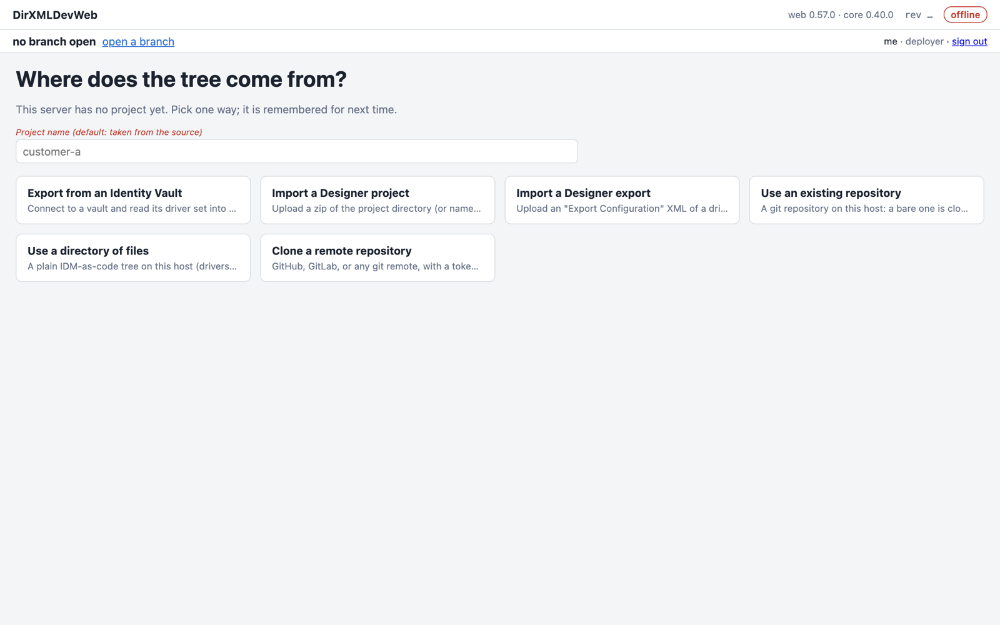

Type a **project name** (this tutorial uses `idm-lab`), then choose **Export from an Identity
Vault**. The page says there is no vault connection yet; follow its **Set up one** link.

## 3. Connect to the vault

A connection has two halves. The *environment* says where the vault is. It is shared by everyone
on a project. *Your connection* says who you bind as. It is yours alone.

**The environment.** Choose **New environment** and fill in:

- **Name**: a short name such as `lab`. You type it later to confirm a deploy.
- **Tier**: `dev` for a lab.
- **Vault URL**: the vault's LDAPS URL.
- **Driver set DN**: the driver set to work on. Once your connection works (below), **Look up**
  under *Definition* lists the driver sets the vault holds.

Leave the rest (SSH host, event store) empty, and **Save**.

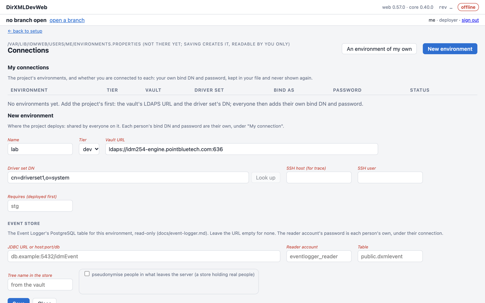

**Your connection.** The environment now shows *not connected*. Choose **Set up…** on its row and
give:

- **Bind DN**: your account in the vault.
- **Accept any certificate**: tick it only for a lab vault, or a tunnel, whose certificate your
  machine does not trust. Leave it clear for anything real.
- **Password**: type it into the password field, and keep "keep it in the environments file". The
  file is readable by you alone, and the page never shows the password again. The other choices
  read it from an environment variable or a secret manager ([secret-managers.md](secret-managers.md)).

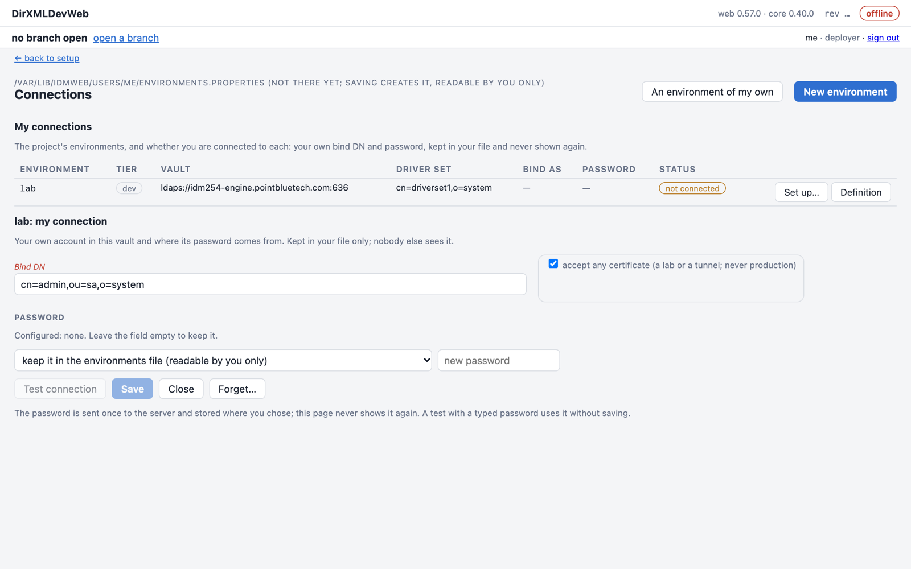

Choose **Test connection**, then **Save**. The row turns *connected*:

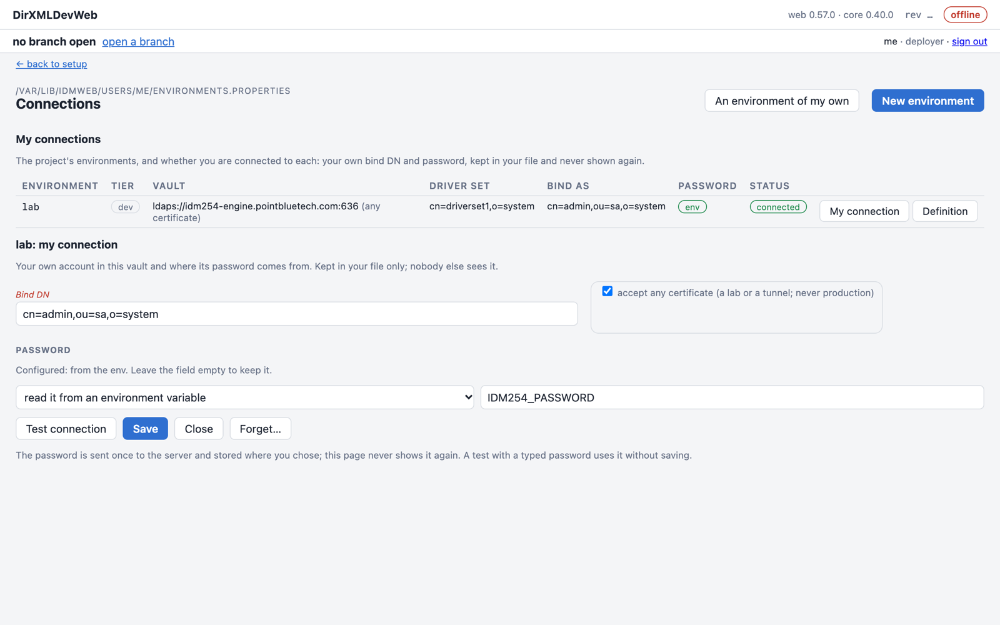

## 4. Read the driver set into a project

Go **← back to setup**, choose **Export from an Identity Vault** again, and pick your environment.
The connection's own driver set is preselected. Choose **Read driverset1** (the button names your
driver set):

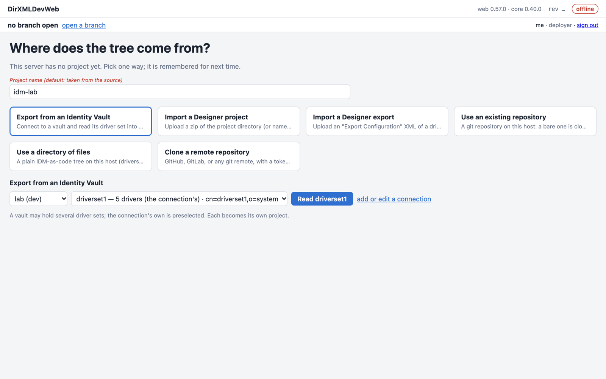

The page reads every driver, policy, filter, GCV, schema map and library object, and writes them as
files: the *tree*. It commits the tree to a new git repository and opens its `main` branch in a
workspace of yours. A driver set of a few drivers takes under a minute.

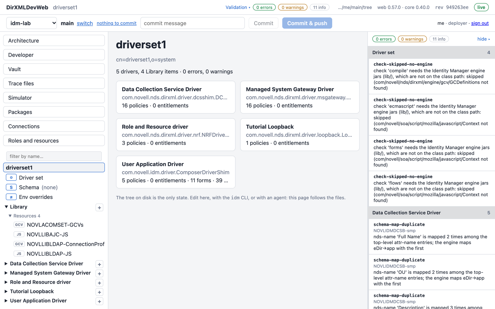

The top bar holds the project (`idm-lab`), the branch (`main`) and the commit controls. The panel
on the right is validation. Without the engine jars, its *info* lines say that the compile checks
were skipped; that is expected, and nothing in this tutorial needs those checks.

The repository is in the install folder, under `data/projects/idm-lab.git`. You can clone it,
or push it on to GitHub or GitLab later.

## 5. Change a policy

Open the driver in the tree on the left. Its **policy flow** shows each channel's policy sets.
Click a policy to open it:

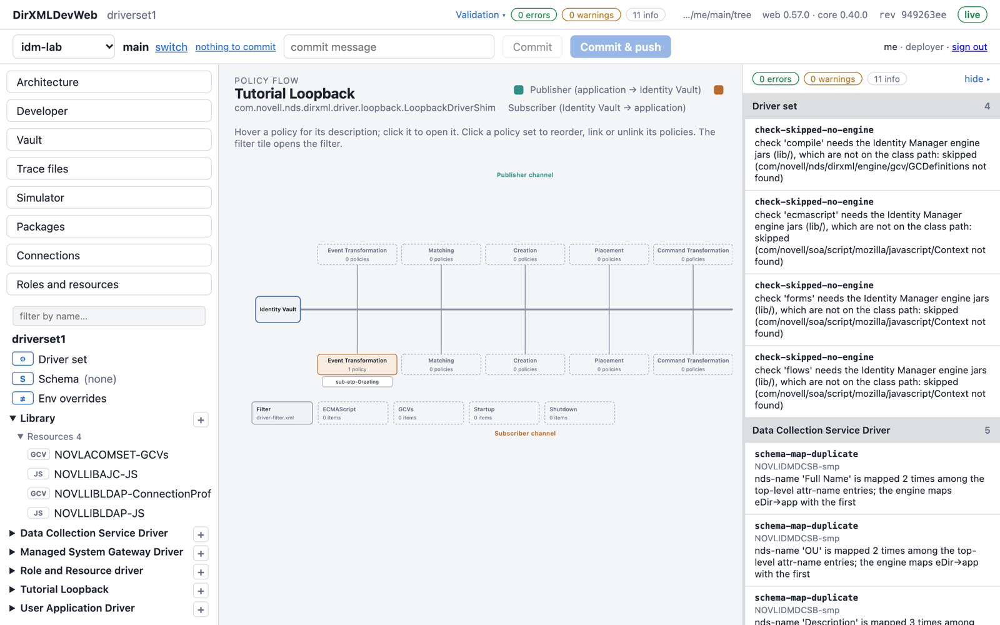

The policy opens in the **Rules** editor: each rule's conditions on the left, its actions on the
right.

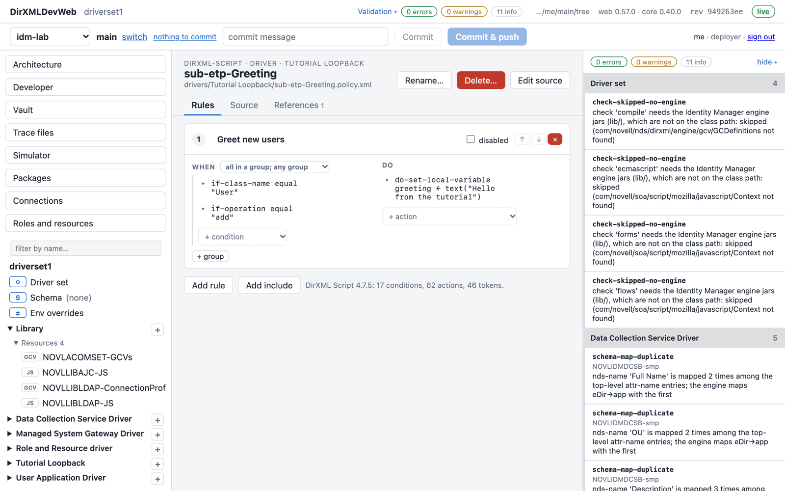

Click the ▸ beside an action to expand it, down to the value you want to change. Here it is the
text of the greeting, changed from "Hello from the tutorial" to "Hello from my first change":

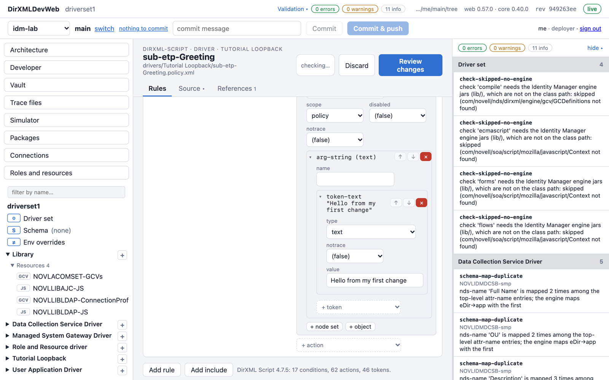

Nothing is written yet. Choose **Review changes**. The review shows the file's XML before and
after, and checks the result:

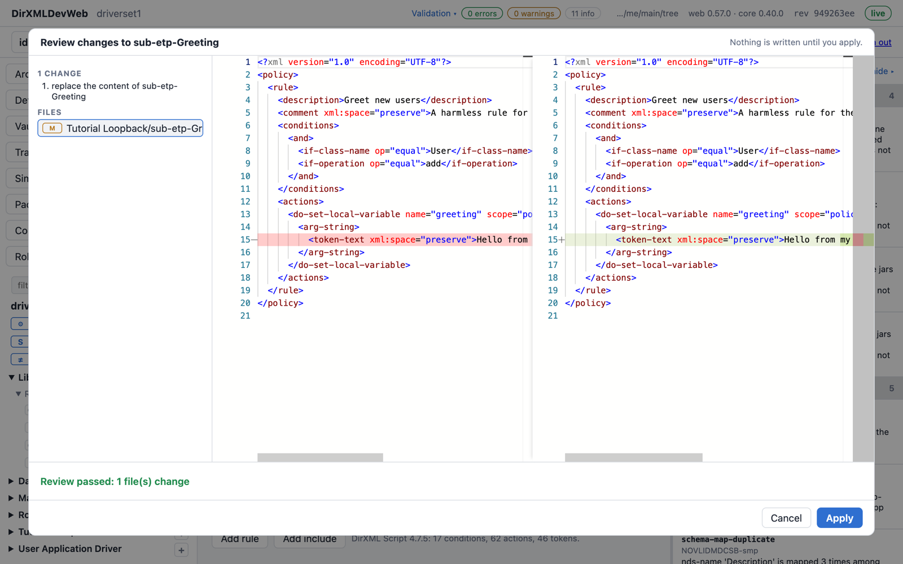

Choose **Apply**. The change is now in your workspace's files, and the top bar shows *1 uncommitted
file*. **Source** shows the policy's XML if you prefer to edit that, and the same review applies.

## 6. Commit it

Type a commit message in the top bar and choose **Commit & push**:

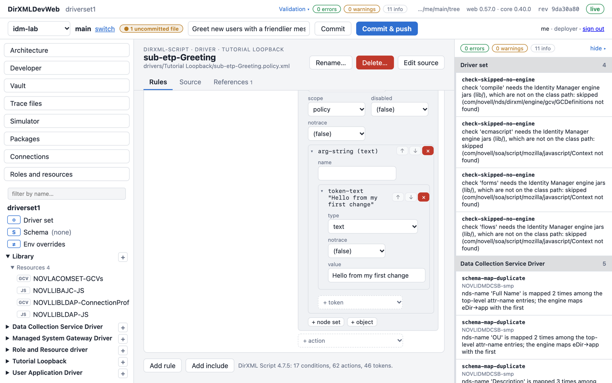

**Commit** records the change on your branch only. **Commit & push** also pushes it to the
project's repository, where other people's branches and the CLI see it. The bar then says
*committed … and pushed*.

On a real project you would work on a branch of your own (**switch** beside the branch name) and
open a pull request. On `main` in a tutorial, committing straight to it is fine.

## 7. Deploy it

Open **Vault** in the left-hand menu, then the **Compare & deploy** tab. Pick the environment and a
**scope**: the whole driver set, or one driver. Choose **Compare**. The page reads the vault and
lists every difference between it and your tree. Here there is one, the changed policy:

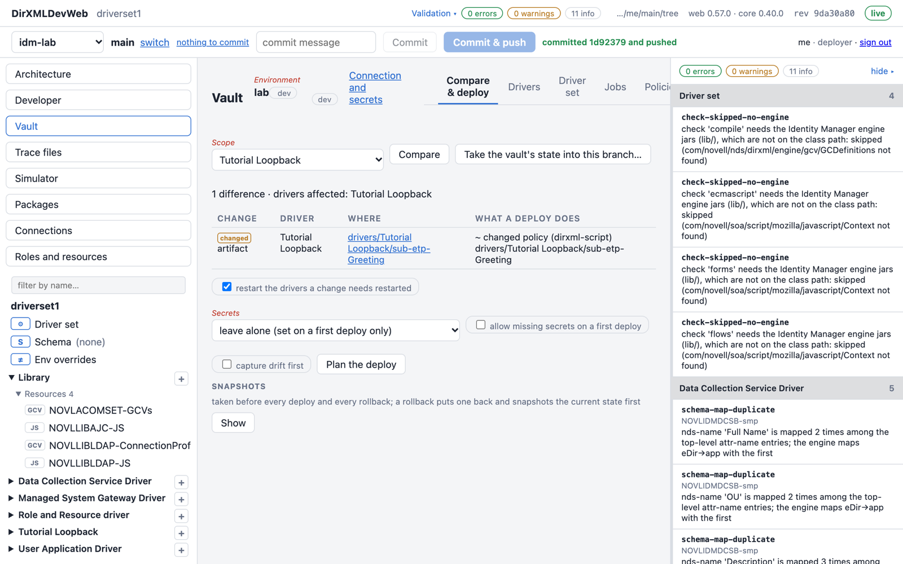

Leave the options as they are:

- **Restart the drivers a change needs restarted**: the engine reads a policy when the driver
  starts, so the driver is restarted after the write.
- **Secrets**: leave alone. A first deploy of a new driver would set them.

Choose **Plan the deploy**. The plan lists each write, and nothing has been written yet. To allow
the writes, type the environment's name, then choose **Deploy to lab**:

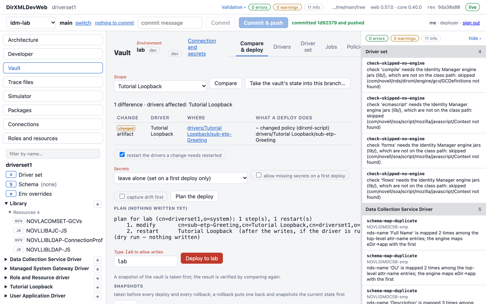

The deploy does four things:

1. It takes a snapshot of what it is about to change.
2. It writes the policy.
3. It restarts the driver.
4. It compares again to verify the vault matches the tree.

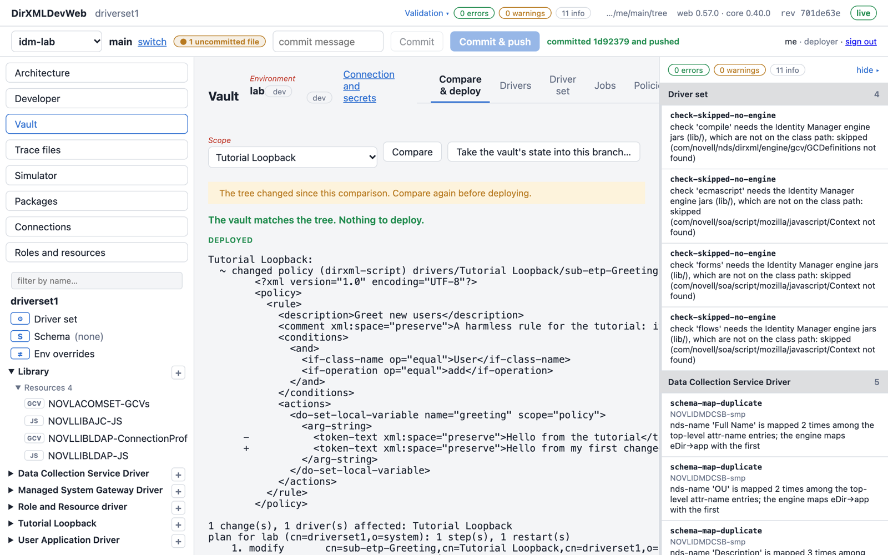

*The vault matches the tree. Nothing to deploy.* Your change is live.

## 8. Commit the deploy record

The top bar shows *1 uncommitted file* again, and the page says the tree changed since the
comparison. That is the deploy's own record. Every deploy adds a line to
`tree/deploy-log/<environment>.jsonl`, with the time, who deployed, the commit deployed, the
snapshot taken and the outcome. Commit it like any change, so the repository records what went
where:

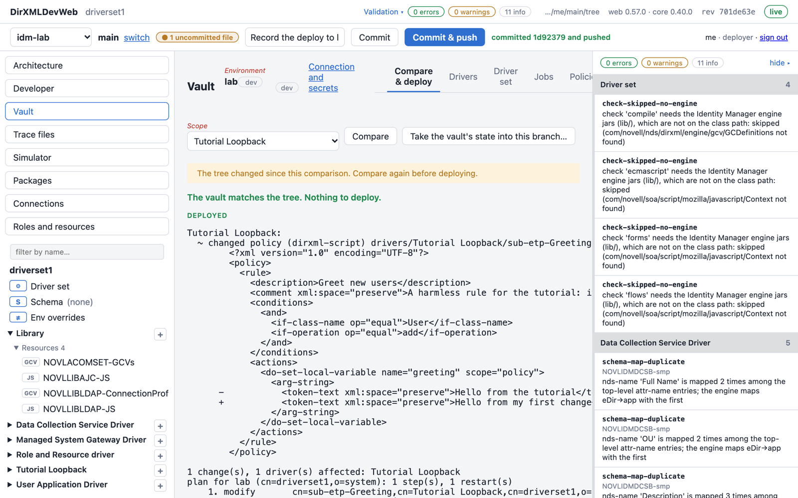

## Where things are

| What | Where |
|---|---|
| The repository | `~/idmweb/data/projects/<project>.git` |
| Your workspace of a branch | `~/idmweb/data/workspaces/<project>/<you>/<branch>`, the files the page and the CLI edit |
| Deploy snapshots | the workspace's `tree/deploy-snapshots/<environment>/`, never committed |
| The deploy record | `tree/deploy-log/<environment>.jsonl`, committed |
| The environments | `~/idmweb/config/environments.properties`; your bind DN and password in `~/idmweb/data/users/<you>/environments.properties` |
| Who did what | `~/idmweb/data/audit.log` |

## If something went wrong

- **Undo a deploy:** **Vault → Compare & deploy → Snapshots → Show** lists the snapshots taken
  before each deploy. Rolling one back puts it back on the vault, and takes a snapshot of the
  current state first.
- **Undo an edit:** **Discard** in the editor, before you apply.
- **The vault changed outside the tree** (someone used Designer or iManager): **Take the vault's
  state into this branch…** on the Compare tab shows what would change in your tree, and Apply
  writes it there for you to commit.

## Next

- The same steps from the command line run in your workspace of the branch you have open:
  `docker exec idmweb idm vault.diff tree --env lab` compares, and
  `docker exec idmweb idm vault.deploy tree --env lab --dry-run` plans a deploy.
- Add the engine jars to the folder's `lib/` for the compile checks and the simulator
  ([quickstart.md](quickstart.md#4-optional-the-engine-jars)).
- [features.md](features.md) lists every view.
- [hosted-install.md](hosted-install.md) is the same server for a team.
